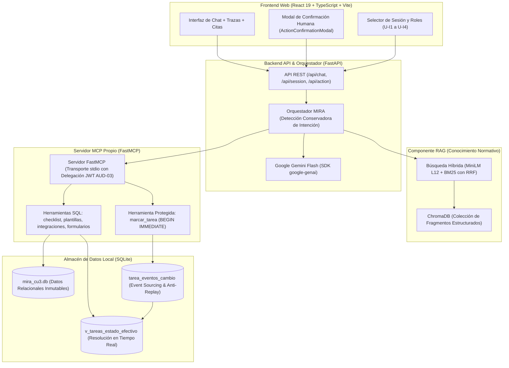

# MIRA CU-3 · Asistente de Incorporación de Organizaciones (Release v3.0)

**Entrega 3 — Taller de Desarrollo de Software Conducido por Agentes de IA**
**Escuela de Ingeniería Informática — Universidad de Valparaíso**
**Caso de Estudio:** MIRA — Plataforma de Inteligencia Multimodal para Decisiones Empresariales (*DPRIME SpA*)

- **Repositorio Oficial:** `https://github.com/elesteber/entrega3-mira-rag-mcp`
- **Etiqueta de Release:** `v3.0`
- **Caso de Uso:** **CU-3 — Asistente de Incorporación de Organizaciones** (*Onboarding Assistant*).
- **Estado del Proyecto:** **Implementación completa, integrada y validada de punta a punta** (React 19 + FastAPI + FastMCP + RAG Híbrido en ChromaDB + SQLite).

---

## 1. Propósito y Principios Operativos (PR-1 a PR-7)

El asistente conversacional atiende las necesidades del **Equipo de Implementación de DPRIME SpA** durante la incorporación de nuevas organizaciones clientes. Permite verificar el avance de tareas por etapa (E0 a E5), validar requisitos de plantillas de negocio (admisión clínica, apertura de cuenta, etc.), cotejar normativas técnicas de integración y preparar la actualización de tareas mediante un flujo seguro de confirmación humana.

El diseño y operación del sistema están regidos por siete principios fundamentales:

| Principio | Significado Operativo | Implementación en MIRA CU-3 |
|---|---|---|
| **PR-1 (Decisión humana)** | El asistente no decide sobre un caso. Explica, sugiere y prepara; la decisión final la toma y confirma una persona. | Flujo en dos fases: el chat solo genera un borrador (`ActionDraft`). La ejecución requiere confirmación en modal. |
| **PR-2 (Evidencia documental)** | Toda afirmación sobre reglas, políticas o contratos cita el fragmento que la respalda con fuente, sección y versión exacta. | Citas desplegables (`CitationCard`) vinculadas a fragmentos indexados de `GUI-INC`, `FIC-PLA`, `REQ-INT` y `POL-FOR`. |
| **PR-3 (Abstención explícita)** | Si la respuesta no está en el corpus, el asistente lo declara abiertamente y explica qué información falta. | Detección de ausencia de evidencia con badge visual de `ABSTENCIÓN`. Sin citas ni respuestas inventadas. |
| **PR-4 (Conflicto entre vigentes)** | Si dos fuentes vigentes difieren, el asistente expone ambas posturas y no elige por su cuenta. | Identificación y presentación simultánea de contradicciones normativas (ej: `FIC-PLA v1 §1` vs `POL-FOR v1 §2`). |
| **PR-5 (Datos vivos vía MCP)** | Todo dato sobre organizaciones y tareas proviene exclusivamente de una llamada registrada al servidor MCP propio. | Consultas SQL parametrizadas sobre SQLite auditadas en el panel "Trazas MCP" con tiempos y argumentos reales. |
| **PR-6 (Acciones con confirmación)** | Las acciones con efecto colateral exigen confirmación humana. Una consulta nunca produce efectos secundarios. | Protocolo de dos pasos: preparación (`ActionProposal` con token efímero HMAC) y confirmación con transacción atómica en SQLite. |
| **PR-7 (Control de acceso por rol)** | El asistente solo permite acceder y operar sobre las organizaciones y etapas autorizadas para el rol del usuario conectado. | Validación estricta en servidor según sesión (`U-I1` a `U-I4`), aislamiento de organizaciones y restricción de etapa E5 a jefatura. |

> **Pregunta de Referencia Oficial:**  
> *«¿Qué le falta a la organización ORG-07 para pasar a producción con la plantilla de admisión clínica?»*

---

## 2. Arquitectura de la Solución

El sistema opera bajo una arquitectura desacoplada que separa el conocimiento normativo (RAG) del acceso a datos relacionales y mutaciones (FastMCP):



---

## 3. Guía de Instalación y Puesta en Marcha Rápida

Sigue estos pasos reproducibles para clonar, configurar y ejecutar el sistema desde cero:

### Paso 1: Clonar el Repositorio y Preparar Python con `uv`
```bash
git clone https://github.com/elesteber/entrega3-mira-rag-mcp.git
cd entrega3-mira-rag-mcp

# Sincronizar dependencias Python con uv
uv sync --extra dev
```

### Paso 2: Instalar Dependencias del Frontend con `npm ci`
```bash
npm --prefix frontend ci
```

### Paso 3: Configurar Variables de Entorno (`.env`)
Copiar las plantillas de configuración de ejemplo:
```bash
cp .env.example .env
cp frontend/.env.example frontend/.env
```

Editar el archivo `.env` en la raíz para configurar:
1. `GEMINI_API_KEY`: Tu clave de API de Google Gemini (obtenida en [Google AI Studio](https://aistudio.google.com/)).
2. `GEMINI_MODEL`: Modelo generativo a utilizar (en la demostración oficial se usó `gemini-3.5-flash-lite`; también compatible con `gemini-3.8-flash`).
3. `JWT_SECRET` y `MIRA_MCP_DELEGATION_SECRET`: Dos secretos independientes de al menos 32 caracteres (generables con `openssl rand -base64 32`).
4. `SQLITE_DB_PATH`: Ruta a la base SQLite (`backend/data/mira_cu3.db` o copia de demo).
5. `CHROMADB_PATH`: Directorio persistente de ChromaDB (`backend/data/chroma_db`).

> [!IMPORTANT]
> En `frontend/.env`, asegurarse de tener `VITE_USE_MOCKS=false` para conectar con el backend real FastAPI + FastMCP + SQLite + RAG.

### Paso 4: Inicializar Base de Datos SQLite y Colección RAG
```bash
# 1. Hidratar base de datos relacional desde el archivo Excel oficial:
uv run python -m backend.data.init_db

# 2. Indexar el corpus documental en ChromaDB (segmentación por encabezados):
uv run python -m backend.rag.index_corpus
```

### Paso 5: Preparar Base de Datos para Demostración Aislada (Opcional pero Recomendado)
Para realizar pruebas con mutaciones reales preservando la base de datos original intacta:
```bash
# Crear la copia de demostración
cp backend/data/mira_cu3.db backend/data/mira_cu3_demo.db
```
En `.env`, configurar temporalmente:
```env
SQLITE_DB_PATH=backend/data/mira_cu3_demo.db
```
*(Para reiniciar la base demo en cualquier momento, basta con volver a copiar `mira_cu3.db` sobre `mira_cu3_demo.db`).*

### Paso 6: Iniciar Servidores de Backend y Frontend

**Terminal 1 — Backend FastAPI:**
```bash
uv run uvicorn backend.app.main:app --host 127.0.0.1 --port 8000
```

**Terminal 2 — Frontend React:**
```bash
npm --prefix frontend run dev
```

Abrir en el navegador: **`http://localhost:5173`**.

---

## 4. Guion de Demostración en Vivo (D1 a D8)

Para reproducir la evaluación en vivo requerida por la pauta oficial, consultar la guía paso a paso detallada en:

👉 **[`docs/demo-v3.md`](docs/demo-v3.md)**

Resumen de los ocho momentos de la demostración:
- **D1 (Cita abierta):** Consulta normativa sobre PLA-ADM / etapa E5 mostrando la cita textual desplegada con fuente, sección y versión.
- **D2 (Abstención):** Pregunta sobre financiamiento o costos ausentes en el corpus con declaración explícita de falta de evidencia (PR-3).
- **D3 (Conflicto vigente):** Exposición simultánea de contradicciones normativas entre `FIC-PLA` y `POL-FOR` sin tomar partido (PR-4).
- **D4 (Trazas MCP):** Consulta del checklist de `ORG-05` con visualización en vivo de la llamada a la herramienta MCP y sus tiempos.
- **D5 (Confirmación humana):** Solicitud conversacional de cambio sobre `T-007` (`pendiente → en_curso`), emisión de borrador, preparación con token efímero y confirmación atómica con Event Sourcing en SQLite.
- **D6 (Control de acceso y E5):** Rechazo ante consulta de organización no autorizada (`ORG-06` para `U-I1`) y restricción de etapa E5 exclusiva para jefatura (`U-I3`).
- **D7 (Cliente MCP externo):** Ejecución de un cliente MCP desacoplado sobre transporte stdio real:
  ```bash
  uv run python scripts/demo_external_mcp_client.py --user U-I1 --tool checklist_organizacion --org ORG-05
  ```
- **D8 (Pregunta imprevista):** Manejo robusto de preguntas no planificadas formuladas por la comisión evaluadora.

---

## 5. Resultados de Evaluación y Pruebas Automatizadas

### Estado de la Suite de Pruebas:
- **Backend:** **350 pruebas aprobadas (1 xfailed conocido)** ejecutadas en `pytest` (`uv run --extra dev pytest tests/ -q -rs`).
- **Frontend:** **62 pruebas aprobadas** en Vitest (`npm --prefix frontend run test`), compilación TypeScript sin errores y ESLint con 0 advertencias.

### Evaluación del Componente RAG:
- **Golden Set:** 22 casos de prueba diseñados con preguntas con respuesta, sin respuesta (trampa), de conflicto vigente y de vigencia histórica (`tests/evaluation/goldenset_cases.json`).
- **Recuperación Documental (Corrida oficial 2026-11-07):**
  - **Recall@4:** **1,00** para las 13 preguntas con respuesta en el corpus.
  - **MRR (Mean Reciprocal Rank):** **0,814**.
  - **Fragmentación seleccionada:** Segmentación por encabezados de sección con ventana de 256 tokens y búsqueda híbrida (MiniLM L12 + BM25 con RRF), superando a la fragmentación de tamaño fijo (ver `docs/decisiones.md` ADR-11).
- **Evaluación de Generación del Golden Set:** Implementada en `tests/evaluation/eval_goldenset.py`; las métricas agregadas automáticas de generación aún se encuentran en fase de medición y calibración.

---

## 6. Estructura de Directorios del Repositorio

```text
entrega3-mira-rag-mcp/
├── .env.example                 # Variables de entorno de ejemplo documentadas
├── AGENTS.md                    # Directrices operativas inmutables para agentes de IA
├── PAUTA_ENTREGA_3.md           # Pauta oficial íntegra del taller
├── README.md                    # Este documento principal
│
├── archivos-base/               # Fuentes primarias inmutables del kit oficial
│   └── Kit_Entrega_3_MIRA/      # Documentos Markdown (corpus/) y datos Excel (datos/)
│
├── backend/                     # Backend FastAPI, orquestador, FastMCP, RAG y SQLite
│   ├── app/                     # API REST y orquestador conversacional
│   ├── data/                    # Esquema relacional SQLite y persistencia ChromaDB
│   ├── mcp/                     # Servidor FastMCP, cliente estándar y middleware stdio
│   ├── rag/                     # Indexador offline, retriever híbrido y citas
│   └── README.md                # Documentación técnica del backend
│
├── frontend/                    # Aplicación web React 19 + TypeScript + Vite
│   ├── src/                     # Chat, tarjetas de citas, trazas MCP y modal de acción
│   └── README.md                # Documentación técnica del frontend
│
├── docs/                        # Documentación técnica, diseño y guion de demostración
│   ├── demo-v3.md               # Guion oficial de demostración en vivo D1–D8
│   ├── decisiones.md            # Registro formal de 13 decisiones de arquitectura (ADRs)
│   ├── auditoria-fuentes.md     # Auditoría de contradicciones y trampas del corpus
│   ├── datos-cu3.md             # Modelo de datos, tablas y reglas de negocio
│   └── corpus-cu3.md            # Inventario del corpus documental y metadatos
│
├── scripts/                     # Scripts utilitarios y de demostración desacoplada
│   └── demo_external_mcp_client.py # Cliente MCP externo para paso D7 vía stdio real
│
├── specs/                       # Especificaciones formales Spec Kit (SDD)
│   └── 001-incorporacion-organizaciones/ # spec.md, plan.md, tasks.md, contratos
│
└── tests/                       # Suite automatizada y framework de evaluación
    ├── integration/             # Pruebas E2E de chat, propuestas, FastMCP y concurrencia
    ├── evaluation/              # Golden Set de 22 casos y scripts de evaluación cuantitativa
    └── clients/                 # Clientes auxiliares de prueba
```
