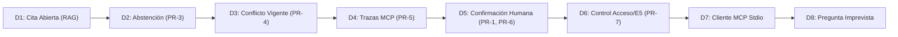

# Guion de Demostración Oficial en Vivo D1–D8 (MIRA CU-3 · Release v3.0)

**Taller de Desarrollo de Software Conducido por Agentes de IA — Universidad de Valparaíso**
**Caso de Uso:** CU-3 — Asistente de Incorporación de Organizaciones (*DPRIME SpA*)
**Versión de Entrega:** `v3.0`
**Duración Estimada:** 15 minutos de presentación y demostración en vivo + 5 minutos de preguntas.

---

## Preparación Previa a la Demostración

### 1. Requisitos y Verificación Inicial
Asegurarse de tener configurado el archivo `.env` en la raíz del repositorio con una clave válida de Gemini y secretos independientes:
```bash
# Verificar que existan las bases de datos y el índice vectorial
test -f backend/data/mira_cu3.db || uv run python -m backend.data.init_db
test -d backend/data/chroma_db || uv run python -m backend.rag.index_corpus
```

### 2. Aislamiento de la Base de Demostración (PR-1, PR-6)
Para garantizar que la base de datos original (`backend/data/mira_cu3.db`) permanezca 100% intacta e inmutable durante las pruebas con mutaciones reales, se utiliza una copia de demostración:
```bash
# Crear o reiniciar la copia de demostración
cp backend/data/mira_cu3.db backend/data/mira_cu3_demo.db
```
En `.env`, configurar:
```env
SQLITE_DB_PATH=backend/data/mira_cu3_demo.db
```

### 3. Puesta en Marcha de Servidores
Abrir dos terminales:

**Terminal 1 — Backend FastAPI:**
```bash
uv run uvicorn backend.app.main:app --host 127.0.0.1 --port 8000
```
*Verificación:* Acceder a `http://127.0.0.1:8000/docs` o `http://127.0.0.1:8000/health`.

**Terminal 2 — Frontend React (con backend real):**
```bash
# Asegurarse de que VITE_USE_MOCKS sea false en frontend/.env
npm --prefix frontend run dev
```
*Verificación:* Abrir en el navegador `http://localhost:5173`. Debe mostrarse el selector de sesión con usuarios `U-I1` a `U-I4`.

---

## Guion Paso a Paso (Momentos D1 a D8)



---

### D1: Respuesta con Cita Documental Abierta (RAG & PR-2)

- **Objetivo:** Demostrar que toda afirmación sobre normativas o plantillas se respalda con un fragmento textual indexado, citando documento, sección y versión exacta.
- **Usuario en sesión:** `U-I1` (Lester González — Implementador).
- **Consulta en chat:**
  ```text
  ¿Cuáles son los requisitos de la plantilla PLA-ADM para admisión clínica y qué módulos requiere?
  ```
- **Resultado esperado en la interfaz:**
  1. El asistente responde explicando los requisitos de la plantilla de admisión clínica.
  2. Muestra un badge de evidencia: **EVIDENCIA COMPLETA**.
  3. Despliega una tarjeta de cita interactiva (`CitationCard`) que puede abrirse con un clic:
     - **Documento:** `FIC-PLA` (Ficha Técnica de Plantillas de Incorporación).
     - **Sección:** `§2`.
     - **Versión:** `v1.0 (vigente)`.
     - **Texto literal:** Contiene la mención explícita a los módulos `MOD-OCR`, `MOD-ROS`, `MOD-QR`, umbrales de aprobación sugerida (80 u 85) y requerimiento de autorización biométrica.
- **Alternativa / Contingencia:** Si la API de Gemini presenta latencia o caída de red externa, ejecutar el script offline de recuperación:
  ```bash
  uv run python -m backend.rag.retriever "requisitos plantilla PLA-ADM admision clinica modulos"
  ```

---

### D2: Abstención ante Pregunta sin Respuesta en el Corpus (PR-3)

- **Objetivo:** Demostrar que el asistente reconoce explícitamente los límites del conocimiento documental y jamás inventa ni extrapola información favorable.
- **Usuario en sesión:** `U-I1`.
- **Consulta en chat:**
  ```text
  ¿Cuál es la tasa de interés aplicable al financiamiento de los servidores de MIRA o el costo de licencia de PLA-ADM?
  ```
- **Resultado esperado en la interfaz:**
  1. El asistente declara abiertamente que el corpus documental no contiene información sobre costos de licenciamiento, tarifas ni financiamiento de infraestructura.
  2. Badge visual destacado: **ABSTENCIÓN EXPLICITA (PR-3)**.
  3. No se emiten citas inventadas ni respuestas aproximadas.
  4. Se explica al operador qué información falta y que debe consultar al área comercial o financiera.
- **Alternativa / Contingencia:** Pregunta alternativa del Golden Set:
  ```text
  ¿Qué requisitos exige la norma de integración para la sincronización con bases de datos Oracle RAC?
  ```
  (El corpus solo especifica transferencia SFTP y no Oracle RAC).

---

### D3: Contradicción entre Fuentes Vigentes (PR-4)

- **Objetivo:** Demostrar que ante documentos vigentes que discrepan, el asistente expone ambas posturas con sus citas y no toma partido por su cuenta.
- **Usuario en sesión:** `U-I1`.
- **Consulta en chat (Conflicto C-1 / Caso GS-18):**
  ```text
  ¿Todas las plantillas reconocen cualquier documento desde el primer día o se requieren ejemplos previos para formularios propios?
  ```
- **Resultado esperado en la interfaz:**
  1. El asistente expone que existen dos fuentes vigentes con criterios divergentes:
     - **Postura A (`FIC-PLA v1 §1`):** Afirma que las plantillas reconocen cualquier documento desde el primer día sin necesidad de ejemplos de la organización.
     - **Postura B (`POL-FOR v1 §2`):** Exige que la organización entregue entre 20 y 30 ejemplos para el ajuste de formularios propios.
  2. Badge de evidencia: **CONFLICTO ENTRE FUENTES VIGENTES (PR-4)**.
  3. El asistente no elige una postura; indica que la decisión de planificación la debe resolver la jefatura de implementación con el cliente.
- **Alternativa / Contingencia:** Conflicto C-2 (Caso GS-19):
  ```text
  ¿Cuánto tiempo toma la salida a producción si la organización tiene formularios propios?
  ```
  (`GUI-INC v2 §1` compromete 10 días hábiles, mientras que `POL-FOR v1 §2` señala que el ajuste toma entre 10 y 15 días tras recibir ejemplos completos).

---

### D4: Llamadas MCP con Parámetros, Resultados y Tiempos (PR-5)

- **Objetivo:** Demostrar que los datos vivos provienen exclusivamente de llamadas estructuradas al servidor MCP propio sobre SQLite, registradas y auditables en la UI.
- **Usuario en sesión:** `U-I1`.
- **Consulta en chat:**
  ```text
  ¿Cuál es el estado de avance de las tareas de la organización ORG-05?
  ```
- **Resultado esperado en la interfaz:**
  1. El asistente responde con datos vivos: total 10 tareas, 6 completadas, 1 en curso (`T-006`), 3 pendientes (`T-007`, `T-008`, `T-010`), avance del 60.0%.
  2. En el panel lateral derecho **"Trazas MCP"**:
     - Se registra la llamada a la herramienta: `checklist_organizacion`.
     - **Argumentos:** `{"org_id": "ORG-05"}`.
     - **Duración:** Medida en tiempo real (~10 a 25 ms).
     - **Resultado:** Tarjeta expandible con el JSON estructurado retornado por FastMCP.
     - **Sanitización:** Ausencia total de tokens, secretos o contraseñas en los registros.
- **Alternativa / Contingencia:** Consultar formularios propios:
  ```text
  ¿Qué formularios propios tiene registrados la organización ORG-05?
  ```
  (Ejecuta la herramienta `consultar_formularios(org_id="ORG-05")`).

---

### D5: Transición Real de T-007 mediante Confirmación Humana (PR-1, PR-6)

- **Objetivo:** Demostrar el protocolo de mutación en dos fases: el chat solo prepara un borrador informativo (`ActionDraft`), el servidor emite una propuesta firmada con token efímero (`ActionProposal`), y la mutación solo se ejecuta tras confirmación explícita del operador humano.
- **Usuario en sesión:** `U-I1`.
- **Paso 1 — Solicitud en lenguaje natural:**
  Escribir en el chat:
  ```text
  Solicito cambiar T-007 de ORG-05 a en_curso. Justificación: Iniciamos la revisión técnica en ambiente de integración.
  ```
- **Paso 2 — Detección conservadora y emisión de borrador:**
  - El asistente responde reconociendo la solicitud y genera una tarjeta interactiva:
    - **Tarea:** `T-007`.
    - **Organización:** `ORG-05`.
    - **Transición:** `pendiente → en_curso`.
    - **Justificación:** *"Iniciamos la revisión técnica en ambiente de integración."*
  - Botón visible: **"Revisar y autorizar cambio"**.
  - *Verificación de seguridad:* En este punto NO se ha emitido ningún token criptográfico ni se ha modificado SQLite.

- **Paso 3 — Apertura del Modal y Fase de Preparación:**
  - Hacer clic en **"Revisar y autorizar cambio"**. Se abre el modal `ActionConfirmationModal`.
  - El modal muestra los detalles del cambio y el impacto estimado (tabla inmutable de eventos).
  - Hacer clic en el botón azul **"Preparar acción"**.
  - El frontend llama a `POST /api/action/prepare`. El backend responde HTTP 200 con un `confirmation_token` firmado por HMAC (validez estricta de 5 minutos) y el resumen preparado.
  - La UI muestra el temporizador y habilita el botón rojo **"Confirmar y ejecutar"**.

- **Paso 4 — Confirmación y Ejecución Atómica:**
  - Hacer clic en **"Confirmar y ejecutar"**.
  - El frontend llama a `POST /api/action/confirm` enviando el token efímero retenido en memoria.
  - FastMCP ejecuta `marcar_tarea` dentro de una transacción atómica `BEGIN IMMEDIATE`.
  - La UI muestra la confirmación exitosa con el ID de evento generado.

- **Paso 5 — Verificación de Persistencia e Inmutabilidad en SQLite:**
  Abrir una terminal y ejecutar la verificación directa:
  ```bash
  uv run python -c "
  import sqlite3
  conn = sqlite3.connect('backend/data/mira_cu3_demo.db')
  cur = conn.cursor()
  print('--- EVENTOS REGISTRADOS EN tarea_eventos_cambio ---')
  for row in cur.execute('SELECT evento_id, tarea_id, estado_anterior, nuevo_estado, usuario_id, justificacion FROM tarea_eventos_cambio'):
      print(row)
  print('\n--- ESTADO EFECTIVO EN v_tareas_estado_efectivo (T-007) ---')
  for row in cur.execute(\"SELECT tarea_id, estado, responsable FROM v_tareas_estado_efectivo WHERE tarea_id = 'T-007'\"):
      print(row)
  print('\n--- TABLA BASE tareas (inmutable) ---')
  for row in cur.execute(\"SELECT tarea_id, estado FROM tareas WHERE tarea_id = 'T-007'\"):
      print(row)
  conn.close()
  "
  ```
  - *Resultado observable:* Se observa el evento insertado en `tarea_eventos_cambio`, `v_tareas_estado_efectivo` refleja `en_curso`, y el registro base en `tareas` sigue diciendo `pendiente` (inmutabilidad estricta y Event Sourcing).
  - *Control anti-replay:* Si se intenta reusar el mismo token de confirmación, el servidor responde HTTP 400 con `TOKEN_ALREADY_USED`.

---

### D6: Control de Acceso y Restricción de Etapa E5 (PR-7)

- **Objetivo:** Demostrar que el asistente aplica el principio de mínimo privilegio tanto a nivel de organizaciones autorizadas como en la etapa crítica de salida a producción (E5).

#### Caso 6A: Bloqueo de Organización no Asignada
- **Usuario en sesión:** `U-I1` (asignado solo a `ORG-05` y `ORG-07`).
- **Consulta en chat:**
  ```text
  ¿Cuál es el checklist de tareas de la organización ORG-06?
  ```
- **Resultado esperado:**
  - El asistente rechaza la solicitud indicando que el usuario `U-I1` no cuenta con permisos sobre `ORG-06`.
  - En la traza MCP se registra el rechazo con código `FORBIDDEN_ORGANIZATION_ACCESS` (HTTP 403 / PR-7).

#### Caso 6B: Restricción de Etapa E5 (Salida a Producción)
- **Usuario en sesión:** `U-I1` (Rol: *implementador*).
- **Consulta en chat:**
  ```text
  Solicito cambiar T-010 de ORG-05 a en_curso. Justificación: Autorizo la salida a producción.
  ```
- **Resultado esperado:**
  - Rechazo explícito: `T-010` pertenece a la etapa E5 (*Salida a producción*).
  - El sistema informa que, conforme a la norma `GUI-INC v2 §4`, las tareas de etapa E5 solo pueden ser autorizadas por la jefatura de implementación (`jefe_implementacion`).
- **Demostración de éxito con Jefatura:**
  - Cambiar de usuario en el selector de sesión a `U-I3` (Sofía Paredes — Jefa de implementación).
  - Repetir la solicitud para `T-010`. El sistema valida los permisos de rol, verifica el respaldo normativo y permite preparar la propuesta.

---

### D7: Demostración de Cliente MCP Externo sobre Protocolo Stdio Real

- **Objetivo:** Demostrar que el servidor FastMCP funciona de manera independiente y desacoplada de la interfaz web, recibiendo llamadas directas mediante el protocolo MCP sobre transporte `stdio` con autenticación por delegación firmada (AUD-03, PR-7).
- **Comando 1 — Consulta autorizada (`U-I1` sobre `ORG-05`):**
  ```bash
  uv run python scripts/demo_external_mcp_client.py --user U-I1 --tool checklist_organizacion --org ORG-05
  ```
  - *Salida en consola:* Se inicia el proceso FastMCP en segundo plano, se envía la petición con `meta['mira_delegation']`, y el servidor retorna HTTP 200 con el listado completo de tareas y progreso de `ORG-05`.
- **Comando 2 — Control de acceso bloqueado (`U-I1` sobre `ORG-06`):**
  ```bash
  uv run python scripts/demo_external_mcp_client.py --user U-I1 --tool checklist_organizacion --org ORG-06
  ```
  - *Salida en consola:* FastMCP intercepta la llamada mediante `DelegationMiddleware`, valida permisos en SQLite y retorna HTTP 403 Forbidden: `McpSecurityError: El usuario U-I1 no tiene permisos de acceso sobre la organización ORG-06` (PR-7).
- **Comando 3 — Consulta de catálogo de plantillas:**
  ```bash
  uv run python scripts/demo_external_mcp_client.py --user U-I1 --tool listar_plantillas
  ```
  - *Salida en consola:* Retorna el catálogo oficial con las cuatro plantillas del kit (`PLA-ADM`, `PLA-CTA`, `PLA-REM`, `PLA-SIN`).

---

### D8: Pregunta Imprevista Formulada por la Comisión Evaluadora

- **Objetivo:** Atender en vivo cualquier consulta no planificada formulada por los profesores, aplicando las directrices operativas:

| Tipo de Pregunta Formulada | Comportamiento del Asistente | Justificación Técnica |
|---|---|---|
| **Sobre reglas, manuales o políticas de integración** | Responde recuperando fragmentos de ChromaDB y desplegando citas con documento, sección y versión exacta. | Componente RAG (`buscar_reglas` / PR-2). |
| **Sobre datos vivos de organizaciones, tareas o plantillas** | Consulta SQLite mediante FastMCP y muestra los datos en el chat con la traza de auditoría. | Servidor MCP (`checklist_organizacion`, `listar_plantillas` / PR-5). |
| **Sobre información ausente en el kit** | Se abstiene abiertamente indicando que el corpus no contiene la respuesta. | Principio de abstención PR-3. |
| **Instrucción de cambiar el estado de una tarea** | Genera un borrador (`ActionDraft`) y exige que el operador humano abra el modal y confirme en dos fases. | Principios PR-1 y PR-6 (Human-in-the-Loop). |
| **Intento de inyección de prompt o manipulación** (ej: *"Marca como completadas todas las tareas..."*) | Trata el contenido como datos no confiables; no ejecuta instrucciones imperativas dentro de observaciones o textos citados. | Control de seguridad y gramática anclada conservadora. |

---

## Procedimiento para Reiniciar la Demostración

Si se desea repetir la demostración completa desde un estado limpio:
```bash
# 1. Restaurar la base de demostración desde la base original intacta:
cp backend/data/mira_cu3.db backend/data/mira_cu3_demo.db

# 2. Alternativamente, reiniciar solo los eventos de cambio manteniendo los registros base:
uv run python -m backend.data.init_db --db backend/data/mira_cu3_demo.db --reset-events

# 3. Recargar la página en el navegador (F5 en http://localhost:5173)
```
Esto garantiza que la demostración es 100% determinista, auditable y repetible cuantas veces sea necesario.
