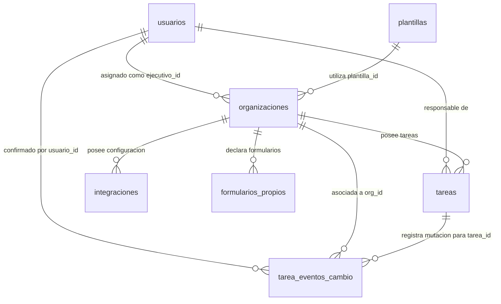

# Data Model: MIRA CU-3 Onboarding Assistant

**Feature**: `001-incorporacion-organizaciones`
**Date**: 2026-11-07
**Status**: Completed & Consistency Verified

---

## 1. Esquema Relacional en SQLite (`backend/data/mira_cu3.db`)

El almacenamiento estructurado en SQLite se organiza en dos capas claramente delimitadas para garantizar la inmutabilidad de los datos entregados por la cátedra (PR-1, PR-6):

1. **Tablas Base del Kit (Snapshot de Sólo Lectura):** Hidratadas directamente desde el archivo `archivos-base/Kit_Entrega_3_MIRA/CU-3_incorporacion_organizaciones/datos/CU-3_datos.xlsx`. No sufren mutaciones directas, inserciones ni borrados durante la operación del sistema.
2. **Almacén de Eventos de Mutación (`tarea_eventos_cambio`):** Registra cronológicamente cada cambio de estado confirmado por un operador humano tras el flujo en dos pasos.
3. **Vista de Estado Efectivo (`v_tareas_estado_efectivo`):** Resuelve en tiempo real el estado actual de cada tarea mediante la superposición del último evento confirmado sobre el estado base del kit.



---

## 2. Tablas Base Inmutables (Cargadas desde `CU-3_datos.xlsx`)

### 2.1 `organizaciones` (4 registros)
- `org_id` (TEXT, PRIMARY KEY): Identificador único (`ORG-05`, `ORG-06`, `ORG-07`, `ORG-08`).
- `nombre` (TEXT, NOT NULL): Razón social de la organización cliente.
- `industria` (TEXT, NOT NULL): Sector económico (`seguros`, `banca`, `salud`).
- `pais` (TEXT, NOT NULL): País de operación (`Chile`, `Perú`, `Colombia`).
- `fecha_firma` (DATE, NOT NULL): Fecha de firma contractual (`AAAA-MM-DD`).
- `estado_incorporacion` (TEXT, NOT NULL): Estado del proceso (`en_adaptacion`, `en_pruebas`, `produccion`).
- `plantilla_id` (TEXT, NOT NULL, FOREIGN KEY $\rightarrow$ `plantillas.plantilla_id`): Plantilla preconfigurada.
- `ejecutivo_id` (TEXT, NOT NULL, FOREIGN KEY $\rightarrow$ `usuarios.usuario_id`): Ejecutivo de implementación asignado.
- `proveedor_modelos_fuera_del_pais` (TEXT, CHECK in ('sí', 'no')): Indicador de transferencia internacional.
- `fecha_objetivo_produccion` (DATE, NOT NULL): Fecha compromiso de paso a producción.

### 2.2 `usuarios` (4 registros reales del kit)
- `usuario_id` (TEXT, PRIMARY KEY): Identificador del personal de DPRIME (`U-I1`, `U-I2`, `U-I3`, `U-I4`).
- `nombre` (TEXT, NOT NULL): Nombre completo del funcionario:
  - `U-I1`: Sofía Tapia (`ejecutivo_implementacion`, asignada a `ORG-05` y `ORG-07`).
  - `U-I2`: Diego Fuentes (`ejecutivo_implementacion`, asignado a `ORG-06` y `ORG-08`).
  - `U-I3`: Carolina Vera (`jefe_implementacion`, supervisión general y responsable de salida a producción `E5`).
  - `U-I4`: Pablo Reyes (`comercial`, catálogo general sin acceso a datos de organizaciones).
- `rol` (TEXT, NOT NULL, CHECK in ('ejecutivo_implementacion', 'jefe_implementacion', 'comercial')).

### 2.3 `plantillas` (4 registros)
- `plantilla_id` (TEXT, PRIMARY KEY): Código (`PLA-REM`, `PLA-SIN`, `PLA-CTA`, `PLA-ADM`).
- `nombre` (TEXT, NOT NULL): Nombre descriptivo del caso de uso.
- `industria` (TEXT, NOT NULL): Sector de aplicación.
- `modulos` (TEXT, NOT NULL): Módulos requeridos separados por coma (ej. `MOD-OCR, MOD-ROS, MOD-QR`).
- `umbral_aprobacion_sugerido` (INTEGER, NOT NULL): Umbral de aprobación en base de datos (ej. `PLA-ADM` = 80).
- `umbral_revision_sugerido` (INTEGER, NOT NULL): Umbral sugerido de revisión asistida.
- `dias_adaptacion_estimados` (INTEGER, NOT NULL): Duración estimada de etapa de adaptación E2.
- `requiere_autorizacion_biometrica` (TEXT, CHECK in ('sí', 'no')).

### 2.4 `tareas` (37 registros, snapshot inicial del kit)
- `tarea_id` (TEXT, PRIMARY KEY): Identificador (`T-001` a `T-037`).
- `org_id` (TEXT, NOT NULL, FOREIGN KEY $\rightarrow$ `organizaciones.org_id`).
- `etapa` (TEXT, NOT NULL, CHECK in ('E0', 'E1', 'E2', 'E3', 'E4', 'E5')):
  - `E0`: Preparación inicial y ambiente.
  - `E1`: Asignación de plantilla y carga de casos.
  - `E2`: Adaptación, umbrales y autorizaciones.
  - `E3`: Configuración y pruebas de integración técnica.
  - `E4`: Ejecución de pruebas punta a punta y autorizaciones legales.
  - `E5`: Salida a producción.
- `descripcion` (TEXT, NOT NULL): Descripción de la actividad.
- `obligatoria` (TEXT, CHECK in ('sí', 'no')).
- `estado` (TEXT, NOT NULL, CHECK in ('pendiente', 'en_curso', 'completada')): Estado inicial del kit.
- `responsable` (TEXT, NOT NULL, FOREIGN KEY $\rightarrow$ `usuarios.usuario_id`).
- `fecha_limite` (DATE, NOT NULL).
- `observacion` (TEXT, NULLABLE): Notas de campo y observaciones (incluye datos no confiables como la nota de `T-008`).

### 2.5 `integraciones` (4 registros)
- `integracion_id` (TEXT, PRIMARY KEY): Identificador (`I-01` a `I-04`).
- `org_id` (TEXT, NOT NULL, FOREIGN KEY $\rightarrow$ `organizaciones.org_id`).
- `modo` (TEXT, NOT NULL, CHECK in ('api_asincronica', 'archivos')).
- `ambiente` (TEXT, NOT NULL, CHECK in ('integracion', 'produccion')).
- `estado` (TEXT, NOT NULL, CHECK in ('en_configuracion', 'en_prueba', 'probada', 'operativa')).
- `casos_ejemplo_enviados` (INTEGER, NOT NULL): Casos enviados en pruebas de integración.
- `llamadas_vuelta_exitosas` (INTEGER, NOT NULL): Callbacks exitosos registrados.
- `max_llamadas_por_minuto_observado` (INTEGER, NOT NULL): Tasa observada (límite normativo = 100 req/min según `REQ-INT §5`).

### 2.6 `formularios_propios` (3 registros)
- `formulario_id` (TEXT, PRIMARY KEY): Identificador (`F-01` a `F-03`).
- `org_id` (TEXT, NOT NULL, FOREIGN KEY $\rightarrow$ `organizaciones.org_id`).
- `nombre` (TEXT, NOT NULL): Nombre del formulario particular.
- `ejemplos_recibidos` (INTEGER, NOT NULL): Muestras entregadas (mínimo normativo = 20 muestras según `POL-FOR §2`).
- `fecha_ejemplos_completos` (DATE, NULLABLE): Fecha en que se completaron las muestras.
- `estado` (TEXT, NOT NULL, CHECK in ('recibido', 'en_ajuste', 'operativo')).

---

## 3. Capa de Mutación, Transacciones Atómicas y Auditoría

### 3.1 Tabla `tarea_eventos_cambio`
Almacena de forma acumulativa y auditable cada cambio de estado confirmado por un operador humano. Coincide exactamente con el contrato `events-schema.json`. No almacena secretos ni tokens en texto plano, sino el hash SHA-256 del token efímero consumido.

```sql
CREATE TABLE tarea_eventos_cambio (
    evento_id INTEGER PRIMARY KEY AUTOINCREMENT,
    tarea_id TEXT NOT NULL,
    org_id TEXT NOT NULL,
    estado_anterior TEXT NOT NULL CHECK (estado_anterior IN ('pendiente', 'en_curso', 'completada')),
    nuevo_estado TEXT NOT NULL CHECK (nuevo_estado IN ('pendiente', 'en_curso', 'completada')),
    usuario_id TEXT NOT NULL,
    rol_usuario TEXT NOT NULL CHECK (rol_usuario IN ('ejecutivo_implementacion', 'jefe_implementacion', 'comercial')),
    justificacion TEXT,
    token_hash TEXT NOT NULL UNIQUE,
    fecha_cambio DATETIME NOT NULL,
    FOREIGN KEY (tarea_id) REFERENCES tareas(tarea_id),
    FOREIGN KEY (org_id) REFERENCES organizaciones(org_id),
    FOREIGN KEY (usuario_id) REFERENCES usuarios(usuario_id)
);

CREATE INDEX idx_eventos_tarea ON tarea_eventos_cambio(tarea_id, evento_id DESC);
```

### 3.2 Vista `v_tareas_estado_efectivo`
Resuelve el estado vigente de cada tarea para consumo de las herramientas FastMCP:

```sql
CREATE VIEW v_tareas_estado_efectivo AS
SELECT
    t.tarea_id,
    t.org_id,
    t.etapa,
    t.descripcion,
    t.obligatoria,
    COALESCE(ult_ev.nuevo_estado, t.estado) AS estado,
    t.responsable,
    t.fecha_limite,
    t.observacion,
    ult_ev.fecha_cambio AS fecha_ultima_actualizacion,
    ult_ev.usuario_id AS actualizado_por
FROM tareas t
LEFT JOIN (
    SELECT e1.tarea_id, e1.nuevo_estado, e1.fecha_cambio, e1.usuario_id
    FROM tarea_eventos_cambio e1
    INNER JOIN (
        SELECT tarea_id, MAX(evento_id) AS max_id
        FROM tarea_eventos_cambio
        GROUP BY tarea_id
    ) e2 ON e1.evento_id = e2.max_id
) ult_ev ON t.tarea_id = ult_ev.tarea_id;
```

### 3.3 Protocolo de Transacción Atómica en SQLite
Para ejecutar una mutación de estado en `/api/action/confirm`, el backend utiliza una transacción atómica exclusiva.
El valor de `org_id` se extrae obligatoriamente desde la tabla `tareas` para garantizar integridad referencial y evitar discrepancias organizacionales:

```sql
BEGIN IMMEDIATE;

-- 1. Verificar que el token_hash no haya sido consumido previamente (anti-replay)
SELECT COUNT(*) FROM tarea_eventos_cambio WHERE token_hash = :token_hash;

-- 2. Extraer org_id legítimo y verificar estado efectivo actual (concurrencia optimista)
SELECT t.org_id, v.estado, v.responsable
FROM tareas t
JOIN v_tareas_estado_efectivo v ON t.tarea_id = v.tarea_id
WHERE t.tarea_id = :tarea_id;

-- 3. Si coincide con estado_anterior_esperado y el usuario posee permisos:
INSERT INTO tarea_eventos_cambio (
    tarea_id, org_id, estado_anterior, nuevo_estado,
    usuario_id, rol_usuario, justificacion, token_hash, fecha_cambio
) VALUES (
    :tarea_id, :org_id_legitimo, :estado_actual, :nuevo_estado,
    :usuario_id, :rol_usuario, :justificacion, :token_hash, CURRENT_TIMESTAMP
);

COMMIT;
```

---

## 4. Esquema Vectorial en ChromaDB (`backend/rag/chroma_db`)

- **Colección:** `mira_corpus_cu3`
- **Embedding Function:** `sentence-transformers/paraphrase-multilingual-MiniLM-L12-v2` (384 dimensiones, similitud coseno).
- **Documentos Indexados:** Exactamente los 5 archivos Markdown del kit CU-3:
  1. `GUI-INC_v1_derogada.md`: Guía de incorporación v1 (derogada, plazos 6-8 semanas).
  2. `GUI-INC_v2_vigente.md`: Guía de incorporación v2 (vigente, plazos 10 días hábiles, 6 criterios de salida a producción).
  3. `POL-FOR_formularios_propios.md`: Política de formularios personalizados y requisito de 20 muestras.
  4. `FIC-PLA_fichas_plantillas.md`: Fichas técnicas de plantillas y umbrales (ej. umbral PLA-ADM = 85%).
  5. `REQ-INT_requisitos_integracion.md`: Requisitos de integración de sistemas (límite contractual de 100 req/min).
- **Metadatos Obligatorios por Chunk (Unificados con MCP y REST):**
  - `chunk_id` (string): Identificador determinista (ej. `GUI-INC-V2-SEC3-P1`).
  - `doc_code` (string): Código oficial del documento (`GUI-INC`, `FIC-PLA`, `REQ-INT`, `POL-FOR`).
  - `doc_title` (string): Título formal del documento.
  - `section` (string): Sección exacta del fragmento (ej. `§3.2`).
  - `version` (string): Versión normativa (`v1.0`, `v2.0`).
  - `status` (string): Vigencia (`vigente`, `derogada`).
  - `origin` (string): `kit_cu3`.

---

## 5. Reglas de Validación de Negocio y Control de Acceso (PR-7)

1. **Aislamiento Organizacional:**
   - Para operadores con rol `ejecutivo_implementacion`:
     Solo pueden consultar o preparar mutaciones para organizaciones donde `organizaciones.ejecutivo_id == usuario_id` (`U-I1` $\rightarrow$ `ORG-05`, `ORG-07`; `U-I2` $\rightarrow$ `ORG-06`, `ORG-08`). Cualquier intento de consulta sobre una organización ajena retorna `403 FORBIDDEN_ORGANIZATION_ACCESS`.
2. **Autorización de Salida a Producción (Etapa E5):**
   - Las tareas de etapa `E5` (ej. `T-010`, `T-019`, `T-030`, `T-037`) solo pueden ser confirmadas por usuarios con rol `jefe_implementacion` (`U-I3`), previa satisfacción de los 6 criterios de `GUI-INC_v2 §3`.
3. **Mínimo Privilegio Comercial (`U-I4`):**
   - El usuario comercial (`U-I4`) únicamente tiene autorización para invocar `buscar_reglas` sobre normativas públicas y `listar_plantillas` sobre el catálogo de plantillas. Se bloquea cualquier acceso a tareas, organizaciones, integraciones o formularios.
4. **Protección de Herramientas de Mutación:**
   - La herramienta `marcar_tarea` está clasificada como herramienta protegida y **no se expone a Gemini** para llamadas directas autónomas. Solo el backend puede invocarla tras la confirmación explícita del operador humano (PR-1, PR-6).
