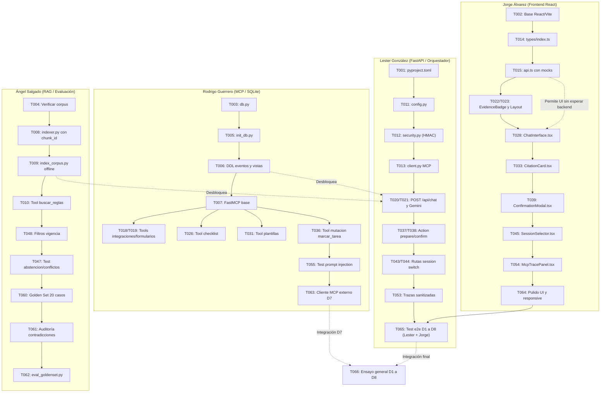

# Tasks: CU-3 Asistente de Incorporación de Organizaciones

**Input**: Documentos de diseño desde `specs/001-incorporacion-organizaciones/` (`plan.md`, `spec.md`, `research.md`, `data-model.md`, `quickstart.md`, `contracts/`).
**Prerequisites**: `spec.md`, `plan.md`, `data-model.md`, `contracts/api-rest.yaml`, `contracts/mcp-tools.json`, `contracts/events-schema.json`.
**Branch de trabajo**: `docs/cu3-plan` (preparación para ramas de feature individuales).

---

## Equipo y Asignación de Responsabilidades

- **[Rodrigo Guerrero]** — Especialista MCP y SQLite: Modelos de datos, importación de Excel, eventos inmutables, herramientas FastMCP relacionales y de mutación protegida, control de acceso SQL, pruebas de concurrencia y pruebas de contención de inyección de prompt (T055).
- **[Jorge Álvarez]** — Especialista Frontend React: Scaffolding en React/Vite, selector de sesión demo, UI de chat, visor de citas con `chunk_id`, panel de trazas MCP, modal de confirmación en dos pasos, pruebas de interfaz y co-liderazgo en pruebas end-to-end de demostración (T065).
- **[Lester González]** — Especialista FastAPI y Orquestación: API REST, middleware de sesión firmada, cliente MCP, integración con Google Gemini Flash (configurable vía `GEMINI_MODEL`), orquestador conversacional y co-liderazgo en pruebas end-to-end de demostración (T065).
- **[Ángel Salgado]** — Especialista RAG y Evaluación: Indexación offline de los 5 documentos en ChromaDB con `chunk_id`, embeddings locales multilingües, herramienta `buscar_reglas`, Golden Set versionado (20 casos), suite de evaluación métrica (Recall@k, precisión de citas) y pruebas de integración de abstención y conflictos normativos (T047).

---

## Formato de Tareas

`- [ ] [ID] [P?] [Responsable] [Story?] Descripción con ruta de archivo concreta`
- **[P]**: Tarea paralelizable (archivos independientes, sin colisiones de edición ni dependencias bloqueantes).
- **[US1] a [US8]**: Mapeo directo a las 8 Historias de Usuario de `spec.md`.
- Rutas explícitas: `backend/app/`, `backend/mcp/`, `backend/rag/`, `backend/data/`, `frontend/src/`, `tests/`.

---

## Phase 1: Setup (Infraestructura y Configuración Inicial de Repositorio)

**Propósito**: Inicialización de entornos de desarrollo, dependencias declaradas y configuración base para permitir trabajo paralelo de los 4 integrantes.

- [X] T001 [P] [Lester González] Configurar `pyproject.toml` con dependencias del proyecto (`fastapi>=0.115`, `uvicorn>=0.30`, `fastmcp>=0.4`, `google-genai>=0.1`, `chromadb>=0.5`, `sentence-transformers`, `pydantic>=2.0`, `pyjwt`, `pytest`, `pytest-asyncio`) y scripts de ejecución con `uv`.
- [ ] T002 [P] [Jorge Álvarez] Revisar e integrar el scaffolding existente en la rama `feat/frontend-chat-ui` dentro de `frontend/` (`package.json`, `vite.config.ts`, `tsconfig.json`, TailwindCSS, `lucide-react`) sin sobrescribir código previo.
- [X] T003 [P] [Rodrigo Guerrero] Crear módulo de configuración de base de datos relacional y conexión con thread-safety en `backend/data/db.py` apuntando a `backend/data/mira_cu3.db`.
- [X] T004 [P] [Ángel Salgado] Verificar rutas y lectura de los 5 archivos del corpus oficial en `backend/rag/verify_corpus.py` comprobando la presencia intacta de los archivos en `archivos-base/Kit_Entrega_3_MIRA/CU-3_incorporacion_organizaciones/corpus/`.

---

## Phase 2: Foundational (Infraestructura Bloqueante y Contratos Base)

**Propósito**: Servicios centrales, esquemas y mocks que deben existir antes de que las historias de usuario puedan integrarse de punta a punta.

**⚠️ CRÍTICO**: Las historias de usuario de las fases posteriores dependen de los artefactos producidos en esta fase.

- [X] T005 [Rodrigo Guerrero] Implementar script CLI de hidratación SQLite en `backend/data/init_db.py` importando las 6 tablas base del kit (`organizaciones`, `usuarios`, `plantillas`, `tareas`, `integraciones`, `formularios_propios`) desde `archivos-base/Kit_Entrega_3_MIRA/CU-3_incorporacion_organizaciones/datos/CU-3_datos.xlsx` en modo sólo lectura.
- [X] T006 [Rodrigo Guerrero] Crear la tabla `tarea_eventos_cambio` y la vista consolidada `v_tareas_estado_efectivo` en `backend/data/init_db.py` conforme a `data-model.md` y `contracts/events-schema.json`.
- [X] T007 [P] [Rodrigo Guerrero] Implementar servidor base FastMCP en `backend/mcp/server.py` configurando el registro modular de herramientas de lectura y de mutación protegida.
- [X] T008 [P] [Ángel Salgado] Implementar pipeline de chunking jerárquico determinista y persistencia en ChromaDB en `backend/rag/indexer.py` asegurando la generación y asignación de `chunk_id` determinista (`doc_code`, `version`, `section`, `status`).
- [X] T009 [Ángel Salgado] Crear script ejecutable de indexación offline en `backend/rag/index_corpus.py` que cargue y vectorice los 5 documentos en `backend/rag/chroma_db` usando `paraphrase-multilingual-MiniLM-L12-v2`.
- [ ] T010 [P] [Ángel Salgado] Implementar herramienta FastMCP `buscar_reglas` en `backend/mcp/tools/rag_tools.py` con filtros por vigencia (`vigente`, `todas`) y retorno de `chunk_id` estructurado según `contracts/mcp-tools.json`.
- [X] T011 [P] [Lester González] Configurar carga de entorno y configuración centralizada con Pydantic Settings en `backend/app/config.py` (`GEMINI_API_KEY`, `GEMINI_MODEL`, `SQLITE_DB_PATH`, `CHROMADB_PATH`, `JWT_SECRET`).
- [X] T012 [P] [Lester González] Implementar módulo de seguridad y emisión de tokens de sesión demo firmados HMAC en `backend/app/security.py` para los 4 usuarios reales del kit (`U-I1`, `U-I2`, `U-I3`, `U-I4`).
- [X] T013 [Lester González] Implementar cliente MCP asíncrono en `backend/mcp/client.py` para invocar herramientas del servidor FastMCP (`server.py`) inyectando el contexto de sesión confiable del operador.
- [ ] T014 [P] [Jorge Álvarez] Definir tipos TypeScript derivados de `contracts/api-rest.yaml` en `frontend/src/types/index.ts` (`SimulatedUser`, `ChatResponse`, `Citation` con `chunk_id`, `McpTrace`, `ActionProposal`).
- [ ] T015 [Jorge Álvarez] Implementar cliente HTTP Axios/Fetch con soporte de mocks de desarrollo y manejo de sesión demo en `frontend/src/services/api.ts`.

**Checkpoint Fundacional**: Base SQLite hidratada, ChromaDB indexado, servidor FastMCP levantado, backend FastAPI con seguridad base y cliente frontend con tipos contractuales.

---

## Phase 3: User Story 1 - Diagnóstico Integral de Salida a Producción (Priority: P1) 🎯 MVP

**Meta**: Permitir a la jefatura o ejecutivos autorizados consultar si una organización cumple los requisitos técnicos y normativos para pasar a producción (`E5`).

**Test Independiente**: Consultar estado de `ORG-07` y `ORG-08`; el sistema debe contrastar tareas efectivas, métricas de integración (tasa de llamadas y callbacks en SQLite) y los 6 criterios de `GUI-INC_v2_vigente.md §3` con citas y alertas técnicas verificables.

### Pruebas para US1
- [X] T016 [P] [Rodrigo Guerrero] [US1] Escribir pruebas unitarias de consulta de integración y detección de límites de tasa (240 req/min vs 100 contractual) en `tests/unit/test_integraciones.py`.
- [X] T017 [P] [Lester González] [US1] Escribir prueba de integración del endpoint `/api/chat` para consulta de diagnóstico de paso a producción en `tests/integration/test_diagnostico_produccion.py`.

### Implementación para US1
- [X] T018 [P] [Rodrigo Guerrero] [US1] Implementar herramienta FastMCP `consultar_integracion` en `backend/mcp/tools/sql_tools.py` retornando telemetría de pruebas y alerta de tasa según `contracts/mcp-tools.json`.
- [X] T019 [P] [Rodrigo Guerrero] [US1] Implementar herramienta FastMCP `consultar_formularios` en `backend/mcp/tools/sql_tools.py` retornando cantidad de muestras y estado de revisión según `contracts/mcp-tools.json`.
- [X] T020 [Lester González] [US1] Implementar ruteador `POST /api/chat` en `backend/app/routers/chat.py` procesando consultas de diagnóstico combinadas (RAG + MCP).
- [X] T021 [Lester González] [US1] Implementar prompt de sistema y ensamblado de contexto en `backend/app/orchestrator.py` instruyendo a Gemini Flash a evaluar los 6 criterios de salida a producción de `GUI-INC_v2 §3`.
- [ ] T022 [Jorge Álvarez] [US1] Implementar componente de diagnóstico y badge de estado de evidencia en `frontend/src/components/EvidenceBadge.tsx`.
- [ ] T023 [Jorge Álvarez] [US1] Integrar vista de diagnóstico en el layout principal en `frontend/src/App.tsx`.

---

## Phase 4: User Story 2 - Consulta del Checklist y Tareas Vivas (Priority: P1)

**Meta**: Consultar el estado vivo de tareas por organización y etapa resolviendo el estado efectivo en SQLite sin alterar el kit original.

**Test Independiente**: Usuario `U-I1` consulta `ORG-05`; retorna 10 tareas efectivas (5 completadas, 1 en curso, 4 pendientes) mediante la vista `v_tareas_estado_efectivo`.

### Pruebas para US2
- [X] T024 [P] [Rodrigo Guerrero] [US2] Escribir pruebas unitarias de consulta sobre `v_tareas_estado_efectivo` y filtros por etapa en `tests/unit/test_checklist.py`.
- [ ] T025 [P] [Jorge Álvarez] [US2] Escribir prueba de renderizado del listado de tareas y progreso porcentual en `frontend/src/tests/Checklist.test.tsx`.

### Implementación para US2
- [X] T026 [Rodrigo Guerrero] [US2] Implementar herramienta FastMCP `checklist_organizacion` en `backend/mcp/tools/sql_tools.py` con resolución sobre `v_tareas_estado_efectivo` y cálculo de progreso según `contracts/mcp-tools.json`.
- [ ] T027 [Lester González] [US2] Conectar la herramienta `checklist_organizacion` en `backend/app/orchestrator.py` exponiéndola al catálogo de Gemini y formateando el resumen de avance en lenguaje natural.
- [ ] T028 [Jorge Álvarez] [US2] Crear componente interactivo de mensajería y visualización de listas de tareas en `frontend/src/components/ChatInterface.tsx`.

---

## Phase 5: User Story 3 - Consulta Normativa y Fichas de Plantillas con Citas Verificables (Priority: P1)

**Meta**: Responder consultas sobre políticas, reglas y plantillas asociando obligatoriamente citas formales con `chunk_id`, documento, versión, sección y extracto textual literal (PR-2).

**Test Independiente**: Consultar requisitos de `PLA-CTA` o plazos de adaptación; el asistente cita `FIC-PLA_fichas_plantillas.md §2` o `GUI-INC_v2_vigente.md §3.2` con su `chunk_id` respectivo, desplegando la tarjeta interactiva en UI.

### Pruebas para US3
- [X] T029 [P] [Ángel Salgado] [US3] Escribir prueba de validación de fidelidad de citas y presencia de `chunk_id` en `tests/unit/test_citations.py`.
- [X] T030 [P] [Rodrigo Guerrero] [US3] Escribir pruebas unitarias de la herramienta `listar_plantillas` en `tests/unit/test_plantillas.py`.

### Implementación para US3
- [X] T031 [Rodrigo Guerrero] [US3] Implementar herramienta FastMCP `listar_plantillas` en `backend/mcp/tools/sql_tools.py` según `contracts/mcp-tools.json`.
- [ ] T032 [Lester González] [US3] Implementar extractor y validador de citas estructuradas en `backend/app/orchestrator.py` asociando cada afirmación al `chunk_id` y metadatos devueltos por `buscar_reglas`.
- [ ] T033 [Jorge Álvarez] [US3] Implementar componente interactivo desplegable de cita en `frontend/src/components/CitationCard.tsx` mostrando `chunk_id`, documento, versión, sección y texto literal.

---

## Phase 6: User Story 4 - Preparación y Confirmación Humana de Actualización de Tareas (Priority: P2)

**Meta**: Flujo seguro en dos pasos para mutar estados de tareas (preparación estructurada -> confirmación en modal de UI -> ejecución atómica con token efímero HMAC y control anti-replay) (PR-1, PR-6).

**Test Independiente**: `U-I1` propone marcar `T-006` de `ORG-05` como completada; el sistema genera token efímero sin alterar SQLite; el usuario confirma en modal; el backend ejecuta transacción atómica en `tarea_eventos_cambio`; la vista `v_tareas_estado_efectivo` refleja el cambio; reusar el token falla con `400`.

### Pruebas para US4
- [X] T034 [P] [Rodrigo Guerrero] [US4] Escribir pruebas unitarias de mutación atómica, concurrencia optimista y anti-replay en `tests/unit/test_mutacion_eventos.py`.
- [X] T035 [P] [Lester González] [US4] Escribir pruebas de integración para `/api/action/prepare` y `/api/action/confirm` en `tests/integration/test_action_flow.py`.

### Implementación para US4
- [X] T036 [Rodrigo Guerrero] [US4] Implementar herramienta FastMCP protegida `marcar_tarea` en `backend/mcp/tools/mutation_tools.py` con transacción atómica SQLite (`BEGIN IMMEDIATE`), verificación de `token_hash` anti-replay y extracción de `org_id` legítimo desde `tareas`.
- [X] T037 [Lester González] [US4] Implementar endpoint `POST /api/action/prepare` en `backend/app/routers/actions.py` validando permisos y emitiendo `confirmation_token` firmado (HMAC-SHA256, TTL 5 min) según `contracts/api-rest.yaml`.
- [X] T038 [Lester González] [US4] Implementar endpoint `POST /api/action/confirm` en `backend/app/routers/actions.py` invocando la mutación protegida y respondiendo con `evento_id` y estado efectivo.
- [ ] T039 [Jorge Álvarez] [US4] Implementar componente modal interactivo de confirmación humana en dos pasos en `frontend/src/components/ConfirmationModal.tsx` con detalle de estados, justificación y botón de confirmación explícito.

---

## Phase 7: User Story 5 - Control de Acceso, Identidad y Autorización por Rol (Priority: P2)

**Meta**: Garantizar que el asistente solo permita acceso y mutaciones sobre las organizaciones asignadas al operador en sesión (`U-I1` a `U-I4`), validado estrictamente en el servidor (PR-7).

**Test Independiente**: Alternar sesión entre `U-I1` y `U-I3`; `U-I1` no puede consultar `ORG-06` ni autorizar etapa `E5` (`T-010`); `U-I4` comercial solo puede ver catálogo general y se le deniega el acceso a tareas.

### Pruebas para US5
- [X] T040 [P] [Rodrigo Guerrero] [US5] Escribir pruebas de aislamiento organizacional y control RBAC en SQLite en `tests/unit/test_rbac_permissions.py`.
- [ ] T041 [P] [Lester González] [US5] Escribir pruebas de endpoints de sesión (`/api/session/users` y `/api/session/switch`) en `tests/integration/test_session.py`.

### Implementación para US5
- [X] T042 [Rodrigo Guerrero] [US5] Incorporar validación de pertenencia de organización y restricción de etapa `E5` (exclusiva de jefatura) en las herramientas de `backend/mcp/tools/sql_tools.py` y `mutation_tools.py`.
- [X] T043 [Lester González] [US5] Implementar ruteador `backend/app/routers/session.py` con endpoints `GET /api/session/users` y `POST /api/session/switch` según `contracts/api-rest.yaml`.
- [ ] T044 [Lester González] [US5] Inyectar middleware o dependencia de autenticación en `backend/app/security.py` que valide el token firmado de sesión demo en cada solicitud entrante.
- [ ] T045 [Jorge Álvarez] [US5] Implementar barra superior con selector de identidad de usuario simulado en `frontend/src/components/SessionSelector.tsx` sincronizada con `POST /api/session/switch`.

---

## Phase 8: User Story 6 - Manejo de Versiones Derogadas, Contradicciones y Abstención Explícita (Priority: P2)

**Meta**: Manejar transparentemente normas derogadas (`GUI-INC v1` vs `v2`), abstenerse explícitamente ante vacíos de información (PR-3) y exponer contradicciones vigentes sin elegir unilateralmente (PR-4).

**Test Independiente**: Consultar plazos históricos vs vigentes (prioriza v2 y cita vigencia); consultar tema no presente en corpus (declara abstención abierta); consultar umbral de `PLA-ADM` (reporta 85% en ficha vs 80% en SQLite).

### Pruebas para US6
- [X] T046 [P] [Ángel Salgado] [US6] Escribir pruebas unitarias de recuperación con filtros de vigencia y detección de normas derogadas en `tests/unit/test_vigencia.py`.
- [X] T047 [P] [Ángel Salgado] [US6] Escribir pruebas de integración sobre respuestas de abstención y reporte dual de conflictos en `tests/integration/test_conflictos_abstencion.py`.

### Implementación para US6
- [X] T048 [Ángel Salgado] [US6] Implementar lógica de filtrado por metadatos de vigencia en `backend/rag/retriever.py` asegurando exclusión de normas derogadas salvo solicitud explícita de histórico.
- [ ] T049 [Lester González] [US6] Configurar directivas del orquestador en `backend/app/orchestrator.py` para activar plantilla de abstención explícita ante score de recuperación insuficiente o ausencia de fragmentos.
- [ ] T050 [Lester González] [US6] Implementar detección y reporte balanceado de contradicciones en `backend/app/orchestrator.py` forzando reporte dual sin toma de partido unilateral.

---

## Phase 9: User Story 7 - Trazabilidad, Auditoría y Transparencia de Evidencias en Interfaz (Priority: P3)

**Meta**: Visibilidad completa y sanitizada de todas las llamadas MCP realizadas durante una consulta (herramienta, parámetros, tiempo en ms y resultado) sin exponer secretos ni tokens en texto plano (PR-5).

**Test Independiente**: Realizar una consulta conversacional; el panel lateral de auditoría despliega las trazas de `checklist_organizacion` o `buscar_reglas` con tiempos reales y parámetros sanitizados.

### Pruebas para US7
- [ ] T051 [P] [Lester González] [US7] Escribir prueba de captura de trazas MCP y sanitización de secretos en `tests/unit/test_mcp_traces.py`.
- [ ] T052 [P] [Jorge Álvarez] [US7] Escribir prueba de renderizado del panel de trazas en `frontend/src/tests/McpTracePanel.test.tsx`.

### Implementación para US7
- [ ] T053 [Lester González] [US7] Implementar decorador e interceptor de trazabilidad en `backend/app/orchestrator.py` capturando métricas de ejecución y sanitizando parámetros sensibles (enmascarando tokens como `[REDACTED]`).
- [ ] T054 [Jorge Álvarez] [US7] Implementar panel lateral desplegable de trazas de auditoría MCP en `frontend/src/components/McpTracePanel.tsx`.

---

## Phase 10: User Story 8 - Resiliencia y Manejo Transparente de Fallos Externos (Priority: P3)

**Meta**: Manejo elegante de caídas del modelo Gemini, timeouts de herramientas o intentos de prompt injection presentes en los datos de prueba (`T-008`).

**Test Independiente**: Consultar observación de `T-008`; el asistente muestra el texto como dato no confiable sin ejecutar la orden de completar tareas; forzar timeout del LLM y verificar mensaje de degradación transparente en UI.

### Pruebas para US8
- [X] T055 [P] [Rodrigo Guerrero] [US8] Escribir prueba de contención de prompt injection de `T-008` en `tests/integration/test_prompt_injection.py`.
- [ ] T056 [P] [Lester González] [US8] Escribir prueba de resiliencia ante falla de conexión con Gemini API en `tests/integration/test_resiliencia_api.py`.

### Implementación para US8
- [X] T057 [Rodrigo Guerrero] [US8] Asegurar que las observaciones y notas de campo se etiqueten explícitamente como datos no confiables en `backend/mcp/tools/sql_tools.py`.
- [ ] T058 [Lester González] [US8] Reforzar el System Prompt en `backend/app/orchestrator.py` con directivas estrictas de aislamiento de directivas textuales en datos (Regla 5 de AGENTS.md).
- [ ] T059 [Lester González] [US8] Implementar manejadores globales de excepciones y códigos de error unificados en `backend/app/main.py` conforme al modelo `ApiError` de `contracts/api-rest.yaml`.

---

## Phase 11: Polish, Integración Cruzada, Demostración (D1 a D8) y Golden Set

**Propósito**: Consolidación del banco de evaluación, interoperabilidad con clientes externos, verificación en vivo de los 8 momentos obligatorios de la pauta docente y preparación de la defensa.

- [X] T060 [Ángel Salgado] Construir el archivo versionado del Golden Set con al menos 20 preguntas en `tests/evaluation/goldenset_cases.json` (12 con respuesta en corpus, 4 de abstención, 2 de versiones normativas y 2 de contradicción documental).
- [X] T061 [Ángel Salgado] Documentar en `tests/evaluation/README.md` la auditoría de contradicciones del corpus: registrar explícitamente como pendiente de validación docente si se identifican 2 contradicciones internas genuinas entre documentos vigentes del corpus, diferenciándolo del caso `FIC-PLA` vs `plantillas.db`.
- [ ] T062 [Ángel Salgado] Implementar script de evaluación métrica automatizada en `tests/evaluation/eval_goldenset.py` calculando `Recall@k`, precisión de citas, tasa de abstenciones correctas y cumplimiento de PR-1..PR-7.
- [X] T063 [P] [Rodrigo Guerrero] Crear script cliente MCP independiente en `tests/clients/test_external_mcp_client.py` para demostrar la conexión de un cliente externo directo al servidor FastMCP para el paso de demostración D7.
- [ ] T064 [Jorge Álvarez] Realizar ajustes finales de interfaz, responsive design, accesibilidad y mensajes de feedback en `frontend/src/App.tsx`.
- [ ] T065 [Lester González, Jorge Álvarez] Implementar script de prueba end-to-end de los 8 momentos de demostración en vivo (D1 a D8) en `tests/integration/test_demo_d1_d8.py` siguiendo `specs/001-incorporacion-organizaciones/quickstart.md`.
- [ ] T066 [Todos] Ensayo general del guion de demostración en vivo (D1 a D8) y verificación final contra `quickstart.md`.

---

## Phase 12: Correcciones de Auditoría Adversarial PR #17 (AUD-01 a AUD-08)

**Propósito**: Resolver los 8 hallazgos identificados en la auditoría adversarial independiente de Codex sobre el PR #17, reforzando la integridad del diagnóstico, la seguridad del transporte MCP, la sanitización de errores, el ciclo de vida de recursos y los límites operativos (PR-1 a PR-7).

- [X] AUD-01 [P] [Lester González] [AUD] Corregir evaluación en `backend/app/orchestrator.py` para distinguir CUMPLIDO, PENDIENTE y SIN_EVIDENCIA, impidiendo que datos ausentes, checklists vacíos o fallas MCP se interpreten como cumplimiento (PR-3, PR-5).
- [X] AUD-02 [Lester González] [AUD] Generalizar y completar diagnóstico de salida a producción en `backend/app/orchestrator.py` evaluando REQ-INT §5 completo (mínimo 20 casos, 100% callbacks, tasa <=100 req/min, ambiente integración), transferencia internacional según organización y biometría según plantilla asignada.
- [X] AUD-03 [Lester González] [AUD] Validar en `backend/mcp/client.py` y `orchestrator.py` que el `org_id` retornado por MCP coincida con el consultado y propagar contexto de identidad de sesión confiable (PR-7): implementación de JWT de delegación (`create_mcp_delegation_token`) con secreto independiente `MIRA_MCP_DELEGATION_SECRET`, envío de `meta={"mira_delegation": credential}` en toda invocación MCP (`call_tool_for_llm`, `call_tool`, `execute_confirmed_mutation`), paso de entorno seguro a `PythonStdioTransport`, aislamiento estricto de identidad desde `SimulatedUser` y sanitización integral de credenciales en trazas. Compatible con contrato `aud-03-auth-stdio.md` de Rodrigo.
- [X] AUD-04 [P] [Lester González] [AUD] Implementar sanitización de errores MCP y códigos/mensajes públicos controlados en `to_api_mcp_trace` asegurando que rutas internas, tokens o secretos no se expongan en trazas públicas ni respuestas HTTP.
- [X] AUD-05 [Lester González] [AUD] Garantía estructural para decisiones normativas en `backend/app/orchestrator.py`: separación de veredicto determinista tipado (`EvaluacionNormativa`, `VeredictoNormativo`, `CriterioDetalle`, `IntencionConsulta`) del texto generativo, eliminación definitiva de listas de palabras clave (`unbacked_approval_markers`), resolución de consultas mixtas con precedencia estricta de decisión determinista y entrega de brechas, política conservadora ante lenguaje ambiguo y preservación de Gemini para consultas informativas y síntesis de brechas puras (PR-1, PR-2, PR-3).
- [X] AUD-06 [Lester González] [AUD] Gestionar el ciclo de vida del cliente MCP en `backend/app/orchestrator.py` y routers garantizando cierre explícito de conexiones y subprocesos stdio ante éxito, excepciones en connect(), cancelaciones y timeouts.
- [X] AUD-07 [Lester González] [AUD] Reforzar clasificación de herramientas en `backend/mcp/client.py` aplicando mínimo privilegio y denegación por defecto (whitelist estricta de consultas y bloqueo de mutaciones desconocidas).
- [X] AUD-08 [Lester González] [AUD] Incorporar límites de entrada en `backend/app/schemas/chat.py` (longitud de mensaje e historial) y timeout explícito no bloqueante para llamadas asíncronas y síncronas a Gemini en `backend/app/orchestrator.py`.

---

## Dependencias y Orden de Ejecución

### Dependencias entre Fases
1. **Setup (Phase 1)**: No tiene dependencias externas; cada integrante puede comenzar inmediatamente su tarea de setup en paralelo.
2. **Foundational (Phase 2)**: Depende de Phase 1. **Bloquea las Historias de Usuario**. Una vez completado el Foundational Checkpoint, se desbloquea el desarrollo en paralelo de las historias de usuario.
3. **User Stories (Phases 3 a 10)**:
   - `US1`, `US2` y `US3` (Prioridad P1) constituyen el núcleo MVP.
   - `US4` y `US5` (Prioridad P2) implementan el protocolo seguro de mutación y el control de acceso estricto.
   - `US6`, `US7` y `US8` completan la trazabilidad, vigencia y resiliencia.
4. **Polish y Demostración (Phase 11)**: Depende de la finalización de las historias de usuario prioritarias.

### Tareas Bloqueantes Críticas
- `T005` y `T006` (Hidratación de SQLite y vistas por Rodrigo) bloquean las herramientas MCP y las consultas de tareas.
- `T008` y `T009` (Indexación ChromaDB por Ángel) bloquean la herramienta `buscar_reglas`.
- `T011` y `T012` (Configuración y seguridad por Lester) bloquean los endpoints protegidos.
- `T014` (Tipos TypeScript por Jorge) bloquea los componentes frontend.

### Estrategia de Trabajo Paralelo por Integrante

---

## Alcance Mínimo para Demostración Funcional (MVP)

Para lograr un sistema demostrable en vivo rápidamente:
1. Completar **Phase 1** (Setup) y **Phase 2** (Foundational).
2. Completar **Phase 3** (Diagnóstico US1) y **Phase 4** (Checklist US2).
3. Completar **Phase 5** (Citas US3) y **Phase 6** (Confirmación en dos pasos US4).
4. Completar **Phase 7** (Selector de sesión US5).
Con este conjunto se cubren de forma operativa los momentos **D1, D4, D5 y D7** del guion oficial.
